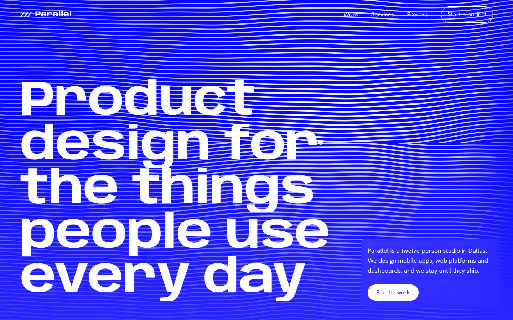

# Parallel

**A website for a (made-up) product design studio, built around one idea: the studio's name, drawn live.**

Live: https://parallel-studio.vercel.app



This started as the Lazarev agency clone I built in HTML/CSS while learning. That version copied someone else's site. This one is an original design with its own brand, written in **Astro** with **GSAP**, **Lenis** and a **Three.js** shader.

## What's on the page

- **A WebGL hero.** A full-screen fragment shader draws ~100 parallel lines. Two octaves of simplex noise make them drift, and your cursor opens a "lens" that pushes the lines apart and thickens them. The lines sweep in from the left on load.
- **Type that moves.** Headlines use Anybody, a variable font with a width axis. The hero title stretches from condensed to wide as it arrives, section titles stretch as you scroll past them, and service names widen on hover.
- **A pinned process section.** "How a project runs" pins to the screen and the four steps slide sideways as you scroll, with a progress bar.
- **Case studies with page morphs.** Each project cover is built in HTML/CSS from the client's palette (a phone, a browser or a dashboard). Clicking one morphs the cover into the case-study header using the View Transitions API.
- **Small touches.** A cursor that turns into a "View case" label over projects, a nav that switches to white text over dark sections, and the studio's local time in the footer.

## Tech

| | |
|---|---|
| Framework | **Astro 7**, static output, content collections for case studies, `<ClientRouter />` view transitions |
| Motion | **GSAP 3** with ScrollTrigger and SplitText, **Lenis** smooth scroll |
| WebGL | **Three.js** `ShaderMaterial` with a custom GLSL fragment shader |
| Type | Anybody (variable width) and Hanken Grotesk |
| Hosting | Vercel |

## How it works

**The shader** (`src/components/LineField.astro`) runs on one full-screen triangle pair. For each pixel it bends the vertical coordinate with noise, offsets it away from the pointer with a Gaussian falloff, and draws a line wherever the result is close to a whole number of line spacings. `fwidth` keeps the lines anti-aliased at any size. The pointer position is eased every frame, the render loop pauses when the hero is off screen or the tab is hidden, and the canvas is torn down before each page swap.

**Animations survive page changes.** Astro's client router swaps pages without a reload, so every GSAP animation is created inside a `gsap.context()` on `astro:page-load` and reverted on `astro:before-swap`. Lenis lives for the whole visit.

**Content.** The four case studies are Markdown files in `src/content/work/`, validated with a Zod schema (client, palette, platform, results), and turned into static pages with `getStaticPaths`.

**Respecting the reader.** With "reduce motion" on, there's no smooth scroll, no scroll-driven animation and the shader stops drifting. The cursor effect is off on touch screens.

## Run it

```bash
npm install
npm run dev       # http://localhost:4321
npm run build     # static site in dist/
```

Parallel, its clients and their results are fictional. Built by [Rahul Singh](https://rahul-dev-portfolio.vercel.app).
